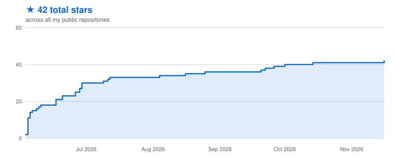

<h1 align="center">Hi, I'm Lechnio 👋</h1>

<b>C++ Developer · Reverse Engineer · Security Researcher</b>

  
  
  

---

### About me

C++ developer with a long-standing focus on IT and application security.
I started as a hobbyist pentesting public-facing services and now work on it commercially:
I lead the development of a cutting-edge **anti-cheat system for multiplayer games** and
**reverse-engineer Windows software**.

Off the clock, I explore where offensive security meets AI: AI-assisted reverse engineering
and vulnerability research, automated tooling, and attacks on the models themselves.
Attackers have always had the advantage of time. AI is compressing it for both sides,
and I intend to stay ahead in that race.

### What I work on

- 🛡️ **Anti-cheat**: game integrity, tamper and injection detection, Windows internals
- 🔍 **Reverse engineering**: Windows binaries, protectors and anti-debug, PE internals
- 🧨 **Offensive security**: researching new attack techniques and building tooling for them
- 🦀 **Currently**: building with **Rust** alongside C++

### Tech & tools

**Languages** 

**Reverse engineering** 

**Platforms & DevOps** 

### Star history

<picture>
  <source media="(prefers-color-scheme: dark)" srcset="assets/stars-dark.svg" />
  <source media="(prefers-color-scheme: light)" srcset="assets/stars-light.svg" />
  
</picture>

### Get in touch

Questions, ideas or collaboration?
Need custom tooling, a reverse-engineering analysis or a security review? I take on selected freelance work.
Feel free to reach out on [**Discord**](https://discord.com/users/589199965444636682).

### Support my work

Everything I publish as open source, I build for fun and out of curiosity, not for money.
But if my tools or research saved you some time, a coffee or a sponsorship is always appreciated:

☕ [Buy Me a Coffee](https://buymeacoffee.com/Lechnio)

### Supporters

<!-- SUPPORTERS:START -->
_No supporters yet. [Be the first!](https://buymeacoffee.com/Lechnio)_
<!-- SUPPORTERS:END -->
